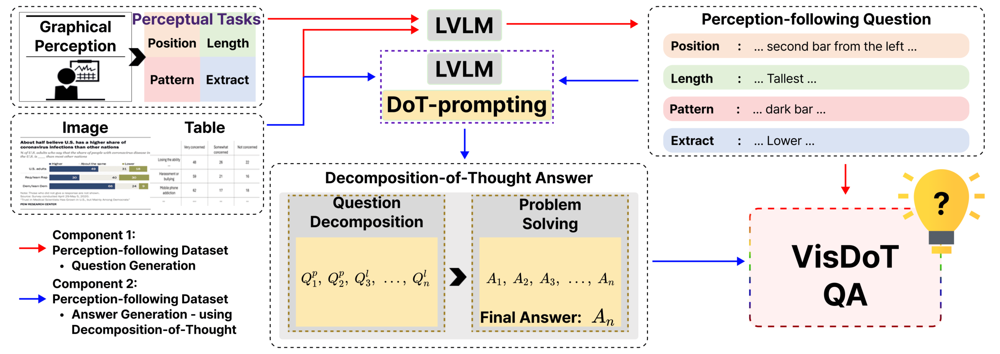
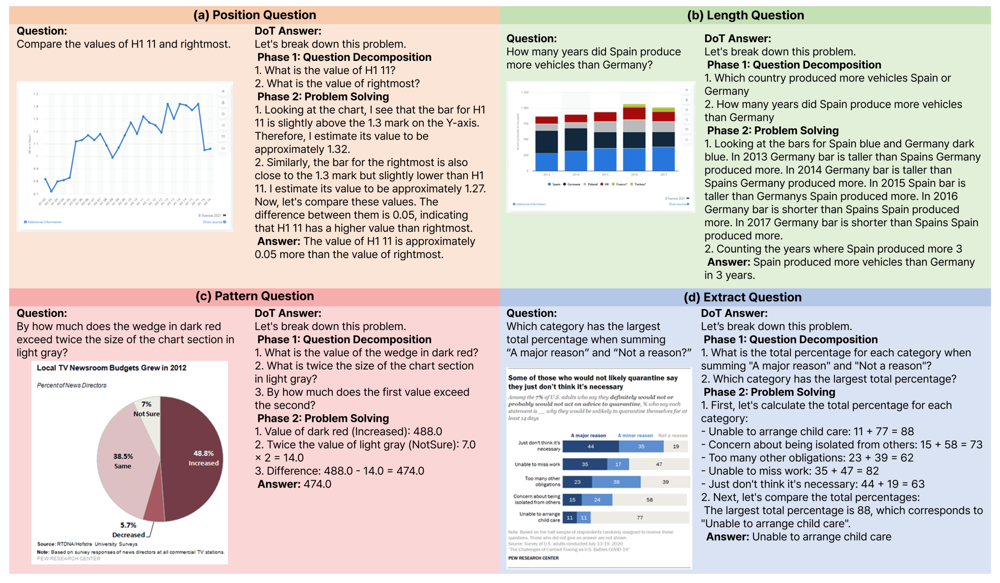
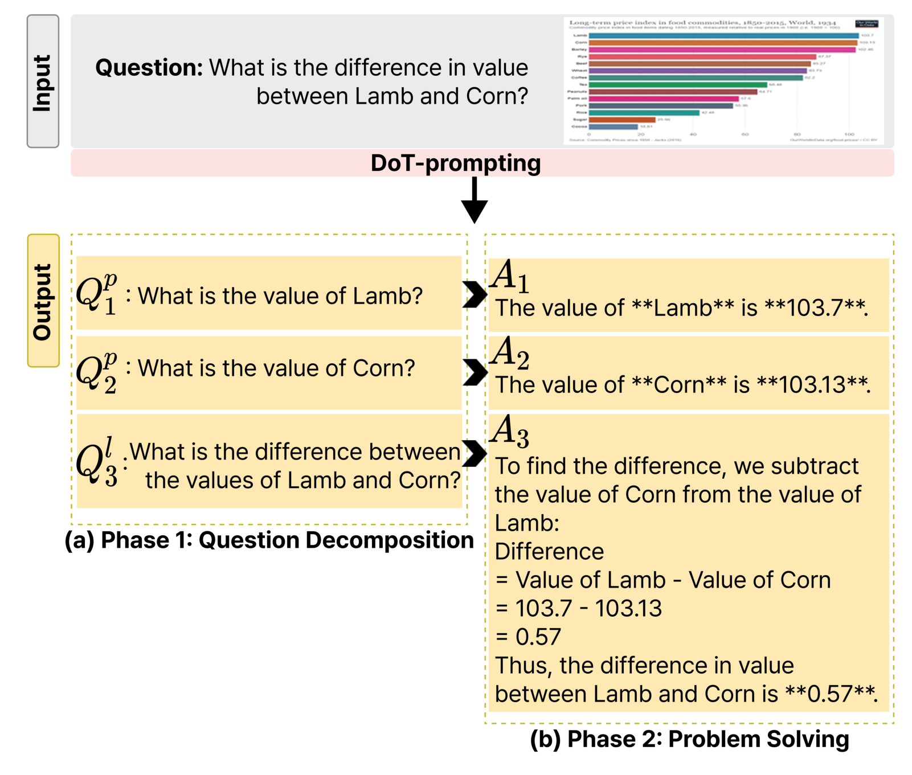

# VisDoT: Enhancing Visual Reasoning through Human-Like Interpretation Grounding and Decomposition of Thought

Eunsoo Lee, Jeongwoo Lee, Minki Hong, Jangho Choi, Jihie Kim

**Findings of EACL 2026**

[Paper](https://aclanthology.org/2026.findings-eacl.30/) · [PDF](https://aclanthology.org/2026.findings-eacl.30.pdf)

- [🔎 About VisDoT](#about-visdot)
- [📊 Dataset Examples](#dataset-examples)
- [📥 Download the Data](#download-the-data)
- [🏆 Results](#results)
- [✅ Citation](#citation)

<a name="about-visdot"></a>

## 🔎 About VisDoT

VisDoT improves chart reasoning by grounding answers in visual evidence before performing logical operations. It combines perception-following supervision across four tasks—**Position, Length, Pattern, and Extract**—with **decomposition-of-thought (DoT)**, which separates a question into perception and logic sub-questions. The resulting reasoning traces are used to fine-tune compact vision-language models.



*Framework overview (Figure 2 in the [paper](https://aclanthology.org/2026.findings-eacl.30.pdf#page=3)).*

<a name="dataset-examples"></a>

## 📊 Dataset Examples

The examples below illustrate the four perceptual task types and their DoT reasoning traces.



*Perception-following QA examples (Figure 3 in the [paper](https://aclanthology.org/2026.findings-eacl.30.pdf#page=4)). Click the image to view it at full size.*

<details>
<summary>🔍 View a step-by-step DoT example</summary>

DoT first decomposes the question into perception and logic sub-questions, then solves them sequentially using the visual evidence and previous answers.



*Question decomposition and problem solving (Figure 4 in the [paper](https://aclanthology.org/2026.findings-eacl.30.pdf#page=5)).*

</details>

<a name="download-the-data"></a>

## 📥 Download the Data

### Training Data

Perception-following chart QA pairs with DoT reasoning traces for fine-tuning.

<!-- Add the Hugging Face training dataset link here after publication. -->

### VisDoTQA Benchmark

Held-out chart questions for evaluating perception-grounded reasoning across the four task types.

<!-- Add the Hugging Face benchmark link here after publication. -->

*Download links have not been added yet.*

<a name="results"></a>

## 🏆 Results

Selected average scores (%) from [Table 3 of the paper](https://aclanthology.org/2026.findings-eacl.30.pdf#page=7).

| Model | ChartQA | ChartQAPro | VisDoTQA |
| :--- | ---: | ---: | ---: |
| GPT-4o | **85.70** | 37.67 | 57.14 |
| Gemini-Flash-2.0 | 85.12 | **46.85** | 61.96 |
| InternVL2.5-2B | 74.16 | 17.81 | 34.20 |
| InternVL2.5-2B + VisDoT | 78.60 | 24.35 | 63.93 |
| InternVL2.5-4B | 75.08 | 32.11 | 43.30 |
| InternVL2.5-4B + VisDoT | 84.36 | 34.54 | **76.52** |

ChartQA scores above use the default output setting; short-answer results († in the paper) are reported separately in Table 3. ChartQA and VisDoTQA use Relaxed Accuracy; ChartQAPro follows its task-specific evaluation protocol. See [Appendix A.3](https://aclanthology.org/2026.findings-eacl.30.pdf#page=12) for details.

<a name="citation"></a>

## ✅ Citation

```bibtex
@inproceedings{lee-etal-2026-visdot,
  title = "{V}is{D}o{T} : Enhancing Visual Reasoning through Human-Like Interpretation Grounding and Decomposition of Thought",
  author = "Lee, Eunsoo and Lee, Jeongwoo and Hong, Minki and Choi, Jangho and Kim, Jihie",
  booktitle = "Findings of the {A}ssociation for {C}omputational {L}inguistics: {EACL} 2026",
  month = mar,
  year = "2026",
  address = "Rabat, Morocco",
  publisher = "Association for Computational Linguistics",
  pages = "610--640",
  doi = "10.18653/v1/2026.findings-eacl.30",
  url = "https://aclanthology.org/2026.findings-eacl.30/"
}
```
